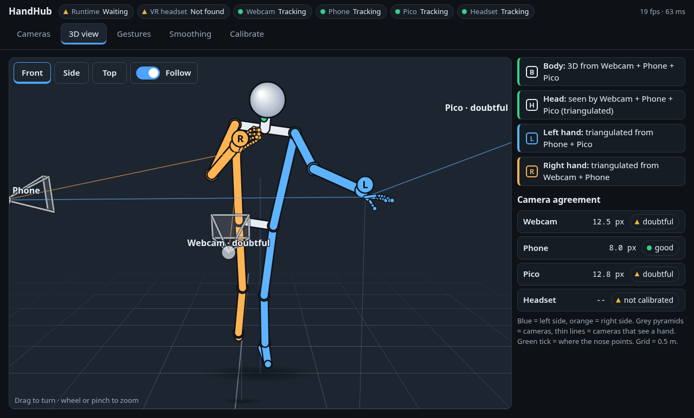

# HandHub

Controller-free PC VR for a phone in a Cardboard-style viewer, on Linux. Cameras you
already own (a laptop webcam, an old Android phone, a microcontroller camera) watch you
from several sides; HandHub finds your hands, head and body in their pictures, works out
where they are in the room, and feeds that to a VR app. The phone in the viewer shows the
PC's VR picture through [WiVRn](https://github.com/WiVRn/WiVRn).

**Status: experimental.** The pieces run end to end, but hand tracking is not yet good
enough to play with. See [What works and what does not](#what-works-and-what-does-not)
before you spend an evening on it.



*The hub's web page, 3D view: the tracked body and hands, the cameras where calibration
put them, and how well each camera agrees with the others.*

## How it works

```
 webcam ────────V4L2───┐
 Android phone ──adb────┼─> hub (Python) ──WebSocket──> test playground (Godot 4, OpenXR)
 serial camera ─serial──┘     │                              ▲
                              │                              │ VR picture
                              └─ web page: live views,   WiVRn server ──Wi-Fi──> phone in the viewer
                                 calibration, settings
```

- **One process per camera** runs MediaPipe hand and pose detection and sends landmarks
  (never pictures) to the hub.
- **Calibration without a target.** You walk around for 30 seconds; the hub finds each
  camera's position from the body landmarks the cameras see at the same time, then refines
  all cameras together. Standing upright once gives it the vertical and, from your height,
  the scale.
- **Fusion.** The cameras never expose at the same instant, and one of them often does
  not see a hand at all. So each palm's position and velocity are kept as a running
  estimate (a Kalman filter), and every picture from any camera corrects it at that
  picture's own time. One camera at a time supplies the hand's shape; a hand no camera
  can make out stays on the end of the forearm the body tracker sees. Left and right
  come from where each hand was a moment ago, the arm it is on and its 3D shape, not
  from the detector's label.
- **Head position** comes from the cameras too, so crouching and leaning work on a phone
  headset that only knows its orientation.

## Supported cameras

Any mix of these, two or more for 3D:

| Source | Connection |
|---|---|
| Webcam or any other V4L2 device | USB or built in |
| Android phone, any of its lenses | adb over USB or Wi-Fi, no app to install |
| Microcontroller camera streaming JPEG over USB serial | USB; protocol in `hub/cameras/pico_serial.py`, firmware not included |

The headset is any Android phone in a Cardboard-style viewer, on the same Wi-Fi as the PC.

## Install

Requirements: Linux, Python 3.11 or newer, `adb` for phone cameras, and for VR
[WiVRn](https://github.com/WiVRn/WiVRn) plus Godot 4.4 or newer for the playground.

```bash
python3 -m venv .venv
.venv/bin/pip install -e ".[dev]"
.venv/bin/python -m pytest -q
```

On first run the hub downloads MediaPipe's hand and pose models and, for phone cameras,
the [scrcpy](https://github.com/Genymobile/scrcpy) server, into `~/.cache/handhub`.

## Run

```bash
.venv/bin/python -m hub          # or scripts/restart-hub.sh to run it in the background
```

Open <http://127.0.0.1:8765>. The page binds to localhost only; `--host 0.0.0.0` opens it
to the network, without authentication.

1. **Cameras** tab: enable your cameras and check that each one sees you. Place them
   around the play area, a metre or two away, roughly at chest height.
2. **Calibrate cameras to each other**: press Start and walk slowly around the play area
   for 30 seconds, pausing in a few places.
3. **Calibration → Standing calibration**: enter your height, stand upright facing the
   laptop.
4. **3D view** tab: you should see yourself as a stick figure with hands, and the cameras
   where they really are.

Recalibrate whenever a camera (or the laptop lid, for its webcam) moves.

### The playground

```bash
playground/run.sh --direct     # desktop window, no headset
playground/run.sh              # VR through the active OpenXR runtime
```

A small room with things to grab and buttons to poke. In VR it keeps itself lined up with
the real room from the camera-tracked head and torso. See `playground/README.md`.

### VR on a phone

WiVRn's client needs an OpenXR runtime on the phone. On a plain Android phone that is
[Monado](https://monado.freedesktop.org/) with its Cardboard driver, plus the Khronos
OpenXR runtime broker. The stock WiVRn client does not start on Mali GPUs and has no way
to be operated without controllers; `runtime/wivrn-client-mali/` holds the patches used
here (see its README). `scripts/wivrn-connect.sh` connects the phone to the PC without
touching the in-headset menu.

Two things to set on the phone, or the session dies after a few minutes: exempt the
Monado runtime and the WiVRn client from battery optimisation, and keep the PC on mains
power with a performance power profile.

## What works and what does not

Works:

- Three cameras tracked at once at their native frame rates on a laptop CPU (when the
  CPU is not power-throttled: check this first if tracking is slow).
- Target-free camera calibration to a few pixels, with a live per-camera health value.
- Body and head tracking in 3D, level and to scale.
- Hand detection for people standing far from a camera, by searching around the wrists
  the body tracker finds.
- Crouching and leaning in the playground, at the right eye height, from your height
  alone when no camera pair sees your feet; your own body drawn as a stick figure there.
- WiVRn streaming to a Mali phone, surviving backgrounding and the screen timeout.

Does not work well yet:

- **Hand position in play.** Better than it was, not proven good enough: on a
  one-minute recording of real play with two fixed cameras, a palm still steps more than
  10 cm some 4 to 10 times (part of that is real fast motion), and where the estimate
  puts a hand is off from where the next picture finds it by 0.5 % of the picture width
  in the median, more than 5 % in 3 % of pictures. This is the main open problem.
- **Camera placement matters more than tuning.** A second camera at 90 degrees to the
  first sees the hands along one line and often only one of them. Around 45 degrees,
  with both cameras in front of the player, is the better layout; a third on the other
  side helps for the same reason.
- Cameras are not time-synchronised. Each view is carried forward along its own motion
  to make up for it, which helps but does not replace a shared clock.
- No lens distortion model and only the fields of view you type in (`hfov_deg` per
  camera). Wrong numbers there hurt everything downstream: the cameras drift apart
  during play, most near the picture edges and close to a camera.
- The hub's output reaches only the bundled playground. Feeding hands into WiVRn itself,
  so that ordinary OpenXR and SteamVR games see them, is not written.
- **The headset phone's own camera** (off by default). The hub fits it to the fixed
  cameras continuously while it runs, and in a slow test that fit holds to under one
  degree. In real play it sits at 3 to 4 degrees and using it makes the hands worse, not
  better. It needs the lens numbers above to be right first.

## Tools

- `tools/record_session.py` records the camera views with the hub's 3D model projected
  back onto them, as a video. The quickest way to see where tracking is wrong.
- `POST /api/record/raw` records detections (no pictures); `tools/replay.py` re-runs the
  fusion on such a recording and scores it.
- `tools/evaluate.py` replays recordings under several settings side by side and prints
  how often the hands jump, flip or twitch, and how well the estimate predicts the next
  picture. Use it before believing that a change helped.

Recordings contain pictures of you and your room. They are written to
`~/.local/share/handhub`, outside the repository, on purpose.

## Licence

HandHub is free software under the GNU General Public License, version 3 or (at your
option) any later version. See `LICENSE`. Third-party components and their licences are
listed in `THIRD_PARTY.md`.
